# Balcão PDV

Sistema de ponto de venda para comércio de pequeno e médio porte, desenvolvido pela **Mokshyaa Soluções**.

Offline-first, personalizável e extensível — feito para funcionar de verdade no dia a dia do comércio de bairro.

---

## Visão Geral

O Balcão PDV nasce da observação de uma realidade comum: o pequeno comerciante que anota vendas e comandas no caderno, perde anotações nos horários de movimento, não controla estoque de forma confiável e depende de sistemas caros ou complexos demais para sua realidade.

Este sistema resolve isso com uma solução simples, acessível e que funciona **mesmo sem internet**: as comandas somam sozinhas, nada se perde, e cada cancelamento fica registrado com motivo.

---

## Screenshots

### PDV — Venda Direta

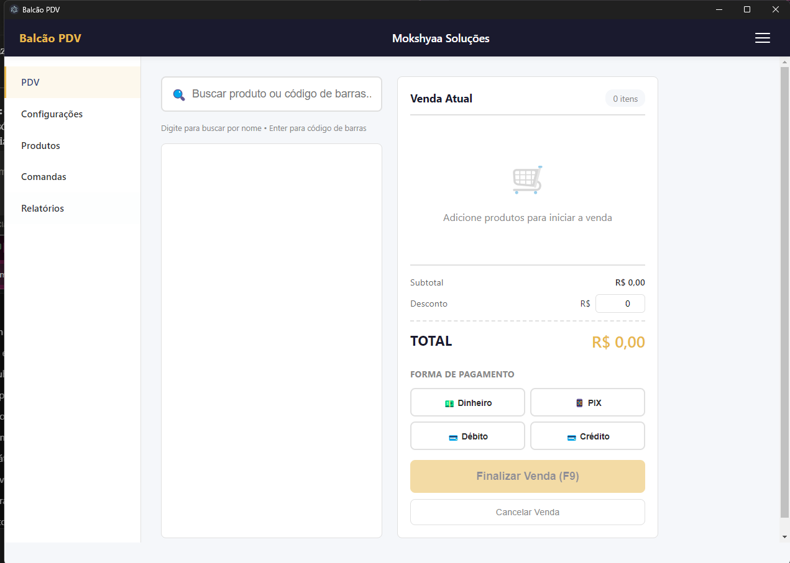

### Item Avulso no PDV

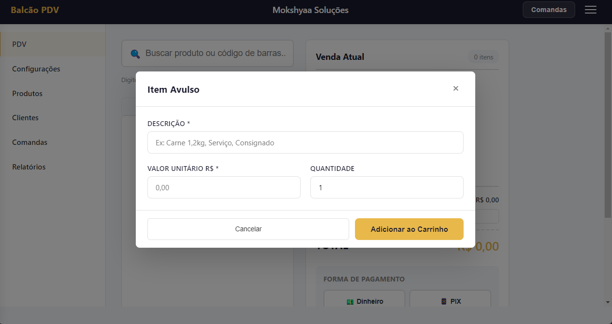

### Comandas

Lançamento por leitor de código de barras, botões −/+ por item, item avulso e total automático.

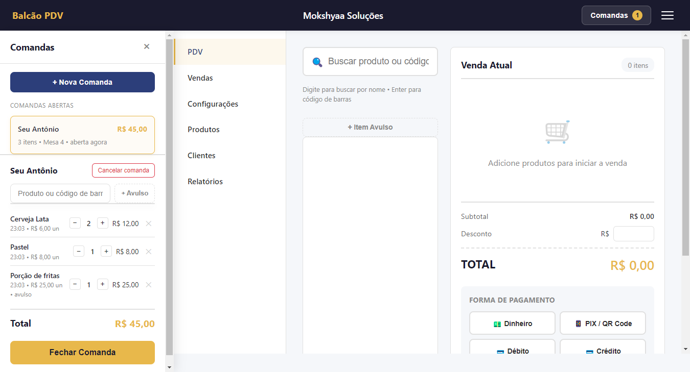

### Histórico de Vendas

Vendas do dia com origem (balcão, comanda ou fiado), itens e cancelamento.

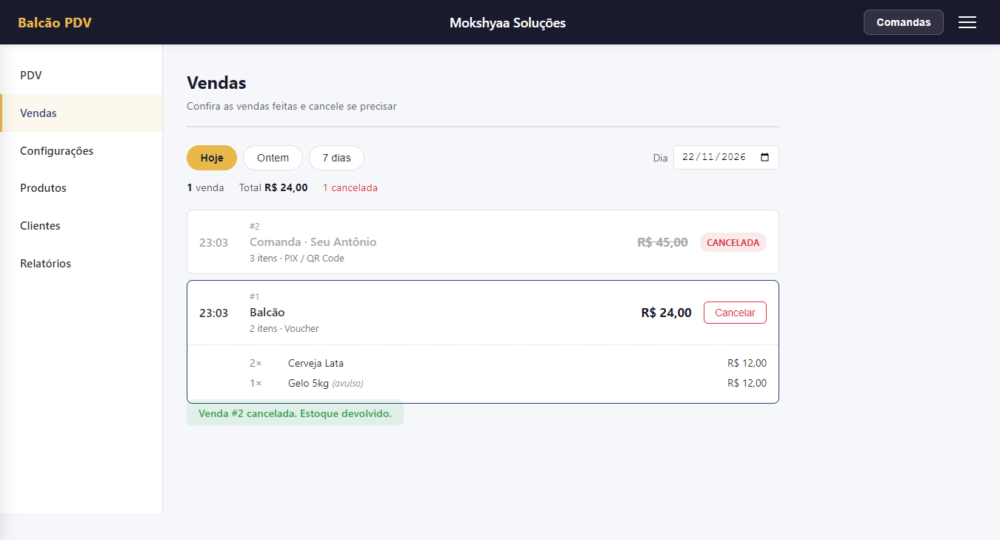

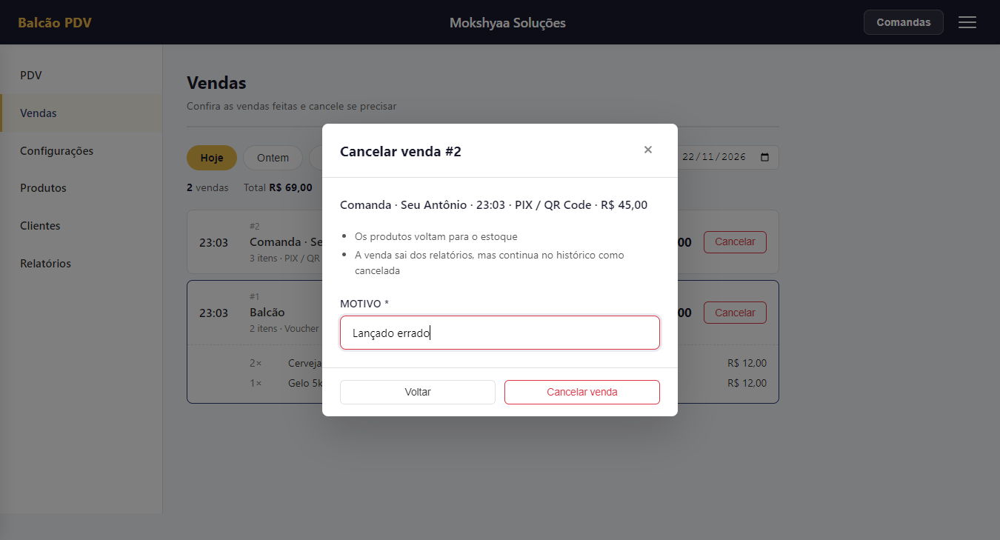

### Produtos — Lista para Controle de Estoque

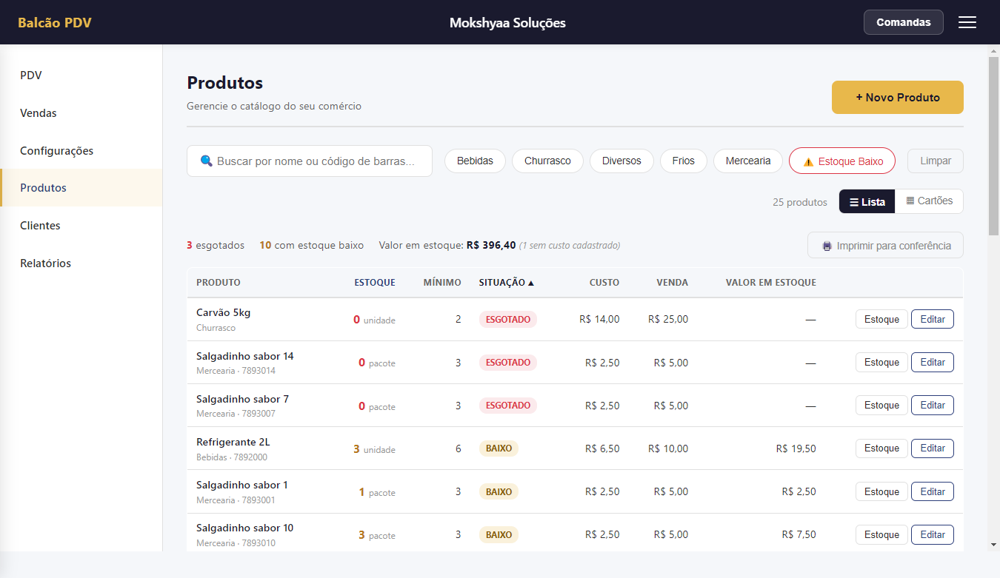

### Produtos — Cartões

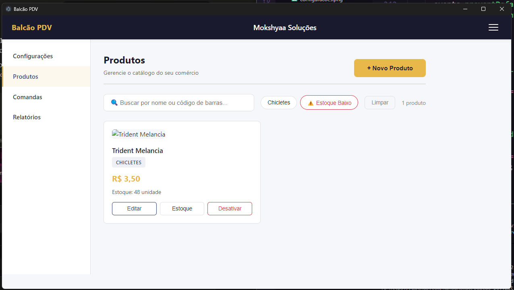

### Conferência de Estoque (impressão)

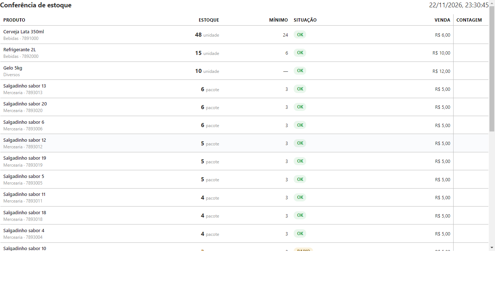

### Clientes & Fiado

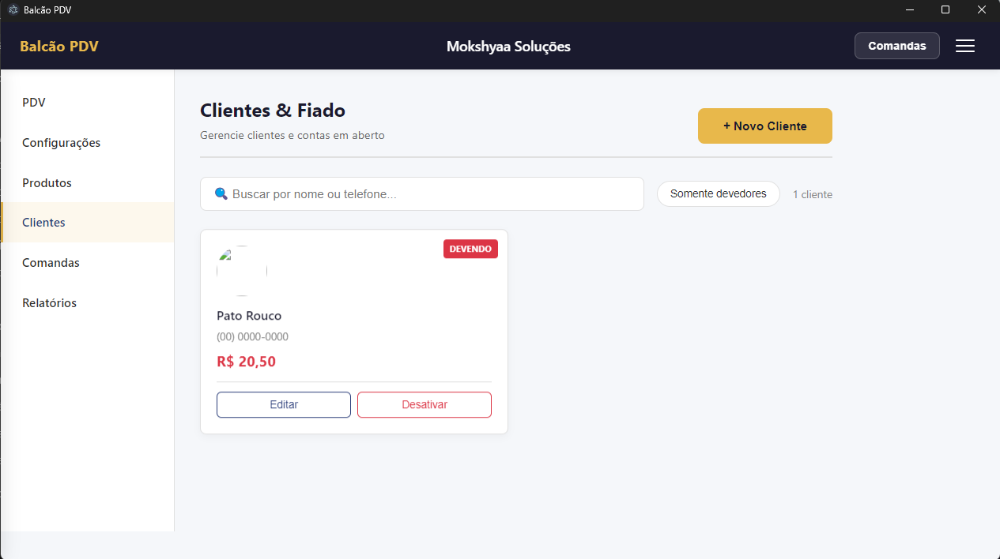

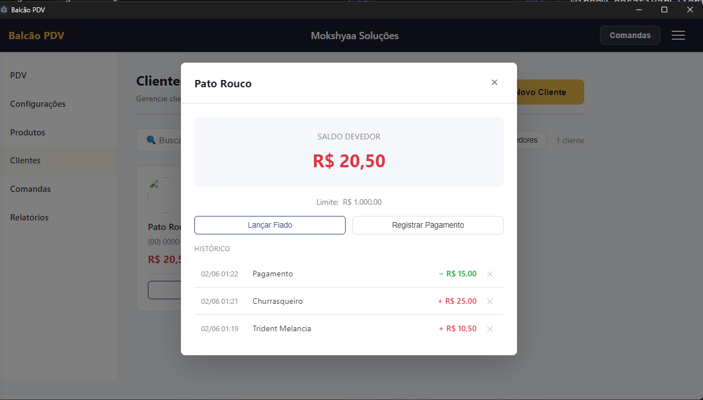

### Relatórios e Reposição

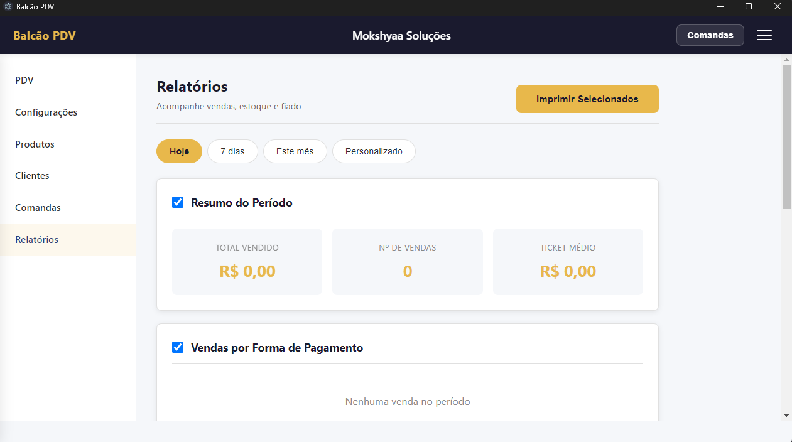

### Configurações e Personalização

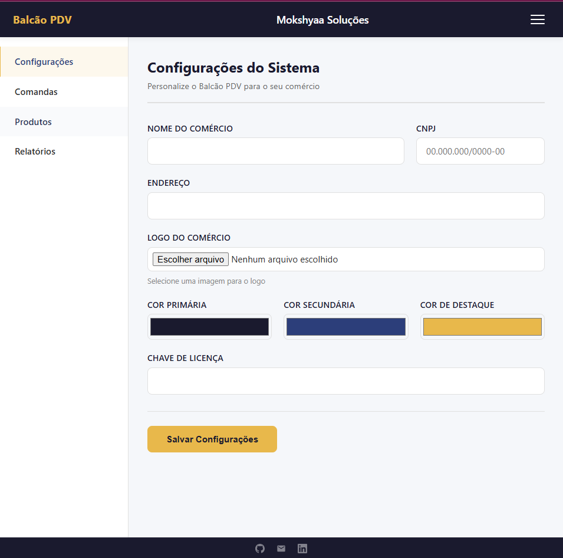

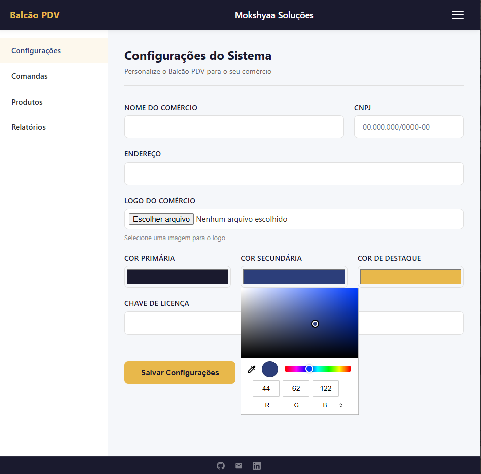

---

## Funcionalidades

- **PDV** — venda direta com leitor de código de barras, carrinho, descontos, cálculo de troco e itens avulsos (produtos sem cadastro, serviços, consignados — sem baixa de estoque). Atalho F9 para finalizar.
- **Comandas** — consumo progressivo para clientes que ficam no local: painel lateral, lançamento por código de barras ou busca, botões −/+ por item, item avulso (porção, couvert), horário de cada item, tempo de comanda aberta e total calculado automaticamente. Itens e comandas podem ser cancelados.
- **Histórico de Vendas** — vendas por dia ou período, com origem (balcão, comanda, fiado), itens, forma de pagamento e troco. Cancelamento com motivo obrigatório: o estoque volta, a venda sai dos relatórios e continua no histórico como cancelada.
- **Produtos e Estoque** — visualização em **lista** (controle de estoque) ou **cartões** (com foto), escolhida automaticamente pela quantidade de produtos. Situação de cada item (esgotado, baixo, ok), colunas ordenáveis, valor parado em estoque, entrada/saída e impressão para conferência com coluna de contagem.
- **Clientes & Fiado** — cadastro de clientes, débito por produto ou avulso, limite de crédito, pagamento parcial e extrato com histórico.
- **Relatórios e Reposição** — resumo do período, vendas por forma de pagamento, produtos mais vendidos, lista de reposição (acabou/acabando) e resumo do fiado, com filtro de período e impressão seletiva.
- **Formas de pagamento** — dinheiro (com troco), PIX / QR Code, débito, crédito, voucher e fiado.
- **Personalização** — logo, nome e paleta de cores por estabelecimento.
- **Offline-first** — tudo funciona sem internet.
- **Fiscal** — emissão de NFC-e via API homologada *(planejado)*
- **Integrações de pagamento** — PIX com QR dinâmico e maquininhas (Stone, Cielo, PagSeguro, Sicoob) *(planejado)*
- **Sincronização** — painel online para acompanhar as vendas pelo celular *(planejado)*

---

## Status do Projeto

| Etapa | Descrição | Status |
| --- | --- | --- |
| Sprint 1 | Fundação — Electron, SQLite, Configurações | ✅ Concluído |
| Sprint 2 | Produtos e Estoque | ✅ Concluído |
| Sprint 3 | PDV — Venda Direta | ✅ Concluído |
| Sprint 4 | Comandas | ✅ Concluído |
| Sprint 6 | Clientes e Fiado | ✅ Concluído |
| Sprint 7 | Relatórios e Reposição | ✅ Concluído |
| Robustez | Migrations versionadas, validação no backend, cancelamento de venda, histórico de vendas, comandas aprimoradas, estoque em lista | ✅ Concluído |
| Uso diário seguro | Backup automático, caixa, login/PIN e auditoria, impressora térmica | 🚧 Próximo |
| Sprint 5 | Fiscal e Pagamentos Avançados | ⏳ Aguardando (depende de CNPJ/certificado) |
| Sprint 8 | Sincronização e Licenciamento | ⏳ Aguardando |
| Sprint 9 | Polish e Empacotamento | ⏳ Aguardando |

O planejamento detalhado, em ordem de prioridade, está em **[docs/ROADMAP.md](docs/ROADMAP.md)**.

---

## Stack

| Camada | Tecnologia |
| --- | --- |
| Desktop | Electron |
| Interface | HTML5 / CSS3 / JavaScript ES6+ |
| Banco local | SQLite via better-sqlite3 (modo WAL) |
| Sincronização | Supabase (Sprint 8) |
| Fiscal | Focus NFe API (Sprint 5) |
| Empacotamento | Electron Builder |

---

## Estrutura do Projeto

```
balcao-pdv/
├── main.js                          # Inicialização do Electron
├── preload.js                       # Ponte segura interface ↔ sistema
├── package.json
├── src/
│   ├── database/
│   │   ├── db.js                    # Conexão SQLite e controle de migrations
│   │   └── migrations/
│   │       ├── 001-setup-inicial.sql
│   │       ├── 002-criar-tabela-produtos.sql
│   │       ├── 003-criar-tabelas-vendas.sql
│   │       ├── 004-criar-tabelas-comndas.sql
│   │       ├── 005-criar-tabelas-fiado.sql
│   │       ├── 006-permitir-produtos-avulso.sql
│   │       └── 007-comanda-avulso-e-cancelamento-venda.sql
│   ├── modules/                     # Regras de negócio (handler) + canais IPC (ipc)
│   │   ├── configuracoes/
│   │   ├── produtos/
│   │   ├── vendas/                  # Venda, histórico e cancelamento
│   │   ├── comandas/
│   │   ├── fiado/
│   │   └── relatorios/
│   └── ui/
│       ├── index.html
│       ├── css/
│       └── js/                      # Um script por tela + utils.js (funções compartilhadas)
└── docs/
    ├── ROADMAP.md                   # Próximas etapas, por prioridade
    └── screenshots/
```

---

## Como Rodar Localmente

**Pré-requisitos:** Node.js instalado.

```bash
# Clone o repositório

git clone https://github.com/NandaRomao/balcao-pdv.git

# Entre na pasta

cd balcao-pdv

# Instale as dependências

npm install

# Se necessário, recompilar o SQLite para o Electron

npm run rebuild

# Rode o sistema

npm start
```

Os dados ficam no arquivo `balcao.db`, na pasta de dados do aplicativo (no Windows: `%APPDATA%\balcao-pdv`). Esse arquivo nunca vai para o repositório.

---

## Princípios do Projeto

**Separação de responsabilidades** — cada arquivo faz uma coisa. A interface nunca acessa o banco diretamente; toda lógica de dados fica nos handlers.

**Offline-first** — todas as operações principais funcionam sem internet.

**Segurança desde o início** — o sistema lida com dinheiro, dívidas de clientes e dados usados pelo contador. Preços, totais, descontos e troco são sempre recalculados no backend a partir do banco; a interface não define valores. Textos vindos do banco são escapados antes de aparecer na tela. Senhas, chaves e certificados nunca entram no código.

**Nada some sem rastro** — vendas canceladas não são apagadas: ficam no histórico com data e motivo, e o estoque é devolvido automaticamente.

**Transações atômicas** — operações que envolvem múltiplas tabelas (fechar venda, fechar comanda, lançar fiado, cancelar venda) usam transações: ou tudo acontece, ou nada acontece.

**Migrations versionadas** — cada alteração do banco roda uma única vez, dentro de uma transação, com a versão registrada no próprio banco. Se uma atualização falhar, ela é desfeita e os dados ficam preservados.

**Saldo calculado, não armazenado** — o saldo devedor do fiado é sempre recalculado a partir dos lançamentos, garantindo que extrato e saldo nunca fiquem dessincronizados.

**Relatórios sobre os dados existentes** — o módulo de relatórios apenas lê e agrega os dados já registrados (vendas, fiado, estoque), sem duplicar informação. Horários são gravados em UTC e exibidos no horário local.

**Extensível** — arquitetura modular permite adicionar novos módulos sem quebrar o que já existe.

**Acessível** — interface pensada para quem não tem familiaridade com tecnologia.

---

## Sobre

Desenvolvido por **Fernanda Romão**

[](https://github.com/NandaRomao)
[](https://www.linkedin.com/in/romaonanda/)
[](mailto:fer.romao@gmail.com)

---

*Balcão PDV — Mokshyaa Soluções*
